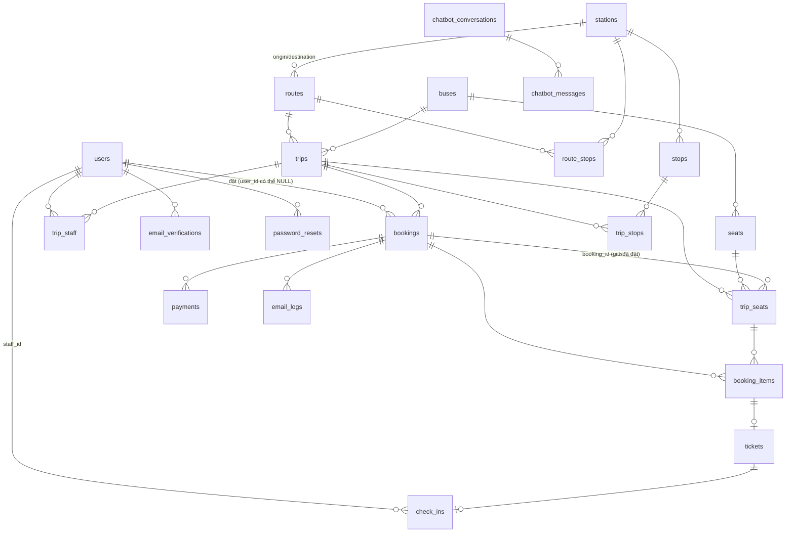

# DATABASE DESIGN – BUS TICKET BOOKING SYSTEM

**Version:** 1.1 **Database:** PostgreSQL **Project:** Bus Ticket Booking System

> Tài liệu này là nguồn chuẩn duy nhất về **bảng, cột, ràng buộc, index và quy tắc transaction**. DESIGN.md và API.md tham chiếu tới tài liệu này, không lặp lại danh sách bảng. Khi có mâu thuẫn, DATABASE.md thắng về dữ liệu; API.md thắng về endpoint.

### Lịch sử thay đổi

| Phiên bản | Nội dung |
|---|---|
| 1.0 | Bản đầu tiên |
| 1.1 | Dùng `trip_seats` làm nguồn duy nhất cho trạng thái ghế theo chuyến (bỏ `seat_holds`); thêm `draft` cho chuyến; thêm `stops` (điểm đón/trả), `trip_staff`, `cancellation_rules`, `email_logs`; bỏ `roles`/`user_roles` (dùng `users.role`), `notifications`, `qr_token_hash`; đổi `booking_details` → `booking_items`; tiền lưu số nguyên VND; thêm ràng buộc `CHECK`, index chống trùng, trigger `updated_at`; thêm hoàn tiền một phần |

------------------------------------------------------------------------

## 1. Mục đích

-   Thống nhất bảng, cột, khóa chính/ngoại, ràng buộc.
-   Bảo đảm các module liên kết được với nhau và dữ liệu đặt vé, ghế, thanh toán nhất quán.
-   Chống đặt trùng ghế **bằng ràng buộc ở tầng database**, không chỉ bằng code.

Mỗi bảng có đúng một thành viên chịu trách nhiệm. Không tự ý tạo bảng trùng hoặc sửa bảng của module khác.

------------------------------------------------------------------------

## 2. Database Convention

### 2.1. Quy tắc đặt tên

| Thành phần | Quy chuẩn | Ví dụ |
|---|---|---|
| Database | snake_case | `bus_ticket_booking` |
| Table | snake_case, số nhiều | `bookings` |
| Column | snake_case | `created_at` |
| Primary key | `id` | `users.id` |
| Foreign key | `<entity>_id` | `trip_id` |
| Boolean | `is_` hoặc `has_` | `is_active` |
| Timestamp | `*_at` | `created_at`, `departure_at` |
| Date | `*_date` | `birth_date` |
| Tiền (VND) | `price`, `*_amount` | `total_amount` |
| Thời lượng | kèm đơn vị | `estimated_duration_minutes` |
| Index | `idx_<bảng>_<cột>`; unique: `uq_<bảng>_<cột>` | `idx_trips_route_id_departure_at` |

Không đặt tên cột trùng từ khóa/hàm SQL (ví dụ `row_number`); dùng `row_no`, `col_no`.

### 2.2. Kiểu dữ liệu **[Chốt]**

| Loại dữ liệu | PostgreSQL |
|---|---|
| ID, khóa ngoại | `INTEGER GENERATED BY DEFAULT AS IDENTITY` (FK: `INTEGER`) |
| Text ngắn | `VARCHAR(n)` |
| Nội dung dài | `TEXT` |
| Số nguyên | `INTEGER` |
| **Tiền VND** | `INTEGER` (không có số lẻ; không dùng `NUMERIC`, `FLOAT`, `REAL`) |
| Boolean | `BOOLEAN` |
| Ngày | `DATE` |
| Ngày giờ | `TIMESTAMPTZ` |
| Token giữ ghế | `UUID` |
| JSON | `JSONB` |

-   `GENERATED BY DEFAULT` (không phải `ALWAYS`) để seed có thể chèn ID cố định. Sau khi seed bằng ID cố định phải chạy `setval` cho sequence của bảng đó.
-   `pg` trả `INTEGER` thành số JavaScript; không đổi kiểu parser mặc định của `pg`.
-   Database và server chạy UTC (`TZ=UTC`); chỉ chuyển sang `Asia/Ho_Chi_Minh` khi hiển thị. Lọc theo "ngày đi" phải quy đổi biên ngày theo `Asia/Ho_Chi_Minh` (ví dụ `departure_at >= $1::date AT TIME ZONE 'Asia/Ho_Chi_Minh'`).

### 2.3. Quy tắc chung

-   Mỗi bảng có khóa chính; khóa ngoại khai báo đầy đủ, `ON DELETE RESTRICT` mặc định (ngoại lệ ghi rõ ở 8.1).
-   Cột quan trọng `NOT NULL`; cột duy nhất có `UNIQUE`; cột trạng thái/loại có `CHECK (... IN (...))`.
-   Bảng nghiệp vụ có `created_at TIMESTAMPTZ NOT NULL DEFAULT now()` và `updated_at TIMESTAMPTZ NOT NULL DEFAULT now()`.
-   **Trigger `set_updated_at()`:** migration đầu tiên (TV5) tạo hàm `set_updated_at()`; mỗi bảng có `updated_at` gắn trigger `BEFORE UPDATE` gọi hàm này. Code ứng dụng không tự gán `updated_at`.
-   Không xóa cứng giao dịch đã phát sinh; dùng `is_active` hoặc cột `status`.
-   Mọi thay đổi cấu trúc đi qua migration; không sửa trực tiếp DB dùng chung.
-   Index không tự tạo cho khóa ngoại trong PostgreSQL; phải khai báo ở mục 8.3.

------------------------------------------------------------------------

## 3. Phân chia quyền sở hữu bảng

| TV | Bảng | Trách nhiệm |
|---|---|---|
| 1 | `users`, `email_verifications`, `password_resets`, `sessions` | Tài khoản, xác thực, phiên đăng nhập |
| 2 | `stations`, `stops`, `routes`, `route_stops`, `buses`, `seats`, `cancellation_rules`, `news`, `promotions`, `faqs`, `policies` | Danh mục và nội dung |
| 3 | `trips`, `trip_stops`, `trip_staff` | Chuyến xe, lịch trình, phân công nhân viên |
| 4 | `trip_seats`, `bookings`, `booking_items`, `payments` | Ghế theo chuyến, đặt vé, thanh toán |
| 5 | `tickets`, `check_ins`, `email_logs`, `chatbot_conversations`, `chatbot_messages` | Vé, soát vé, email, chatbot |

Ngoại lệ: hàm `set_updated_at()` và extension (`btree_gist`) do **TV5** tạo trong migration đầu tiên. Bảng `sessions` do `connect-pg-simple` mô tả (TV1 tạo bằng migration).

Cần thay đổi bảng của người khác thì trao đổi với chủ sở hữu trước.

------------------------------------------------------------------------

## 4. Cấu trúc bảng

Quy ước cột: mọi bảng có `id` (PK, theo 2.2). Bảng nghiệp vụ có thêm `created_at`, `updated_at` (theo 2.3) dù không liệt kê lại ở từng bảng, trừ khi ghi chú khác.

### 4.1. Module 1 – Auth & Users (TV1)

**`users`**

| Cột | Kiểu | Ràng buộc / Ghi chú |
|---|---|---|
| full_name | VARCHAR(150) | NOT NULL |
| email | VARCHAR(255) | NOT NULL; `UNIQUE (lower(email))` (không phân biệt hoa thường) |
| phone | VARCHAR(20) | NULL; **không** UNIQUE (người thân có thể dùng chung số) |
| password_hash | VARCHAR(255) | NOT NULL, bcrypt |
| role | VARCHAR(20) | NOT NULL, `CHECK IN ('customer','staff','admin')`, mặc định `customer` |
| status | VARCHAR(20) | NOT NULL, `CHECK IN ('active','locked')`, mặc định `active` |
| email_verified_at | TIMESTAMPTZ | NULL; NULL = chưa xác thực, không đăng nhập được |

Guest không có dòng trong `users`. Mỗi người một vai trò (`users.role`); không dùng bảng `roles`/`user_roles`.

**`email_verifications`** và **`password_resets`** (cùng cấu trúc)

| Cột | Kiểu | Ràng buộc / Ghi chú |
|---|---|---|
| user_id | INTEGER | NOT NULL, FK `users.id` ON DELETE CASCADE |
| token_hash | VARCHAR(255) | NOT NULL, **UNIQUE** (lưu SHA-256 của token) |
| expires_at | TIMESTAMPTZ | NOT NULL (xác thực: 24 giờ; đặt lại mật khẩu: 1 giờ) |
| used_at | TIMESTAMPTZ | NULL |
| created_at | TIMESTAMPTZ | NOT NULL DEFAULT now() |

**`sessions`** — theo mẫu của `connect-pg-simple`: `sid VARCHAR PK`, `sess JSON NOT NULL`, `expire TIMESTAMP(6) NOT NULL`, index trên `expire`.

### 4.2. Module 2 – Catalog & Content (TV2)

**`stations`** (bến xe)

| Cột | Kiểu | Ràng buộc / Ghi chú |
|---|---|---|
| name | VARCHAR(150) | NOT NULL |
| address | TEXT | NOT NULL |
| province | VARCHAR(100) | NOT NULL (tên tỉnh/thành chuẩn, dùng cho autocomplete và tìm kiếm) |
| latitude | NUMERIC(10,7) | NULL |
| longitude | NUMERIC(10,7) | NULL |
| is_active | BOOLEAN | NOT NULL DEFAULT true |

**`stops`** (điểm đón/trả thuộc bến)

| Cột | Kiểu | Ràng buộc / Ghi chú |
|---|---|---|
| station_id | INTEGER | NOT NULL, FK `stations.id` |
| name | VARCHAR(150) | NOT NULL |
| address | TEXT | NOT NULL |
| stop_type | VARCHAR(10) | NOT NULL, `CHECK IN ('pickup','dropoff','both')` |
| is_active | BOOLEAN | NOT NULL DEFAULT true |

**`routes`**

| Cột | Kiểu | Ràng buộc / Ghi chú |
|---|---|---|
| name | VARCHAR(200) | NOT NULL |
| origin_station_id | INTEGER | NOT NULL, FK `stations.id` |
| destination_station_id | INTEGER | NOT NULL, FK `stations.id`; `CHECK (origin_station_id <> destination_station_id)` |
| estimated_duration_minutes | INTEGER | NULL, `CHECK > 0` |
| distance_km | NUMERIC(10,2) | NULL |
| is_active | BOOLEAN | NOT NULL DEFAULT true |

**`route_stops`** (các bến dừng dọc tuyến)

| Cột | Kiểu | Ràng buộc / Ghi chú |
|---|---|---|
| route_id | INTEGER | NOT NULL, FK `routes.id` ON DELETE CASCADE |
| station_id | INTEGER | NOT NULL, FK `stations.id` |
| stop_order | INTEGER | NOT NULL, `CHECK > 0` |
| offset_minutes | INTEGER | NULL (số phút từ lúc xuất bến) |

`UNIQUE (route_id, stop_order)`, `UNIQUE (route_id, station_id)`.

**`buses`**

| Cột | Kiểu | Ràng buộc / Ghi chú |
|---|---|---|
| license_plate | VARCHAR(20) | NOT NULL, UNIQUE |
| bus_name | VARCHAR(150) | NULL |
| bus_type | VARCHAR(20) | NOT NULL, `CHECK IN ('seat','sleeper','limousine')` |
| status | VARCHAR(20) | NOT NULL, `CHECK IN ('active','maintenance','retired')` |

Tổng số ghế **không lưu** mà đếm từ `seats` (dữ liệu tính lại được).

**`seats`** (sơ đồ ghế cố định của xe; **không** có trạng thái bán)

| Cột | Kiểu | Ràng buộc / Ghi chú |
|---|---|---|
| bus_id | INTEGER | NOT NULL, FK `buses.id` |
| seat_number | VARCHAR(20) | NOT NULL (ví dụ `A01`) |
| seat_type | VARCHAR(20) | NOT NULL, `CHECK IN ('standard','vip','sleeper')` |
| floor | SMALLINT | NOT NULL DEFAULT 1, `CHECK IN (1,2)` |
| row_no | INTEGER | NULL |
| col_no | INTEGER | NULL |
| is_active | BOOLEAN | NOT NULL DEFAULT true (ghế hỏng vĩnh viễn trên xe) |

`UNIQUE (bus_id, seat_number)`. Sơ đồ ghế của xe đã có chuyến phát sinh giao dịch không được xóa/sửa số ghế; chỉ đặt `is_active = false`.

**`cancellation_rules`** (chính sách hủy có cấu trúc)

| Cột | Kiểu | Ràng buộc / Ghi chú |
|---|---|---|
| min_hours_before_departure | INTEGER | NOT NULL, `CHECK >= 0`, UNIQUE |
| refund_percent | INTEGER | NOT NULL, `CHECK BETWEEN 0 AND 100` |
| is_active | BOOLEAN | NOT NULL DEFAULT true |

Cách áp dụng: lấy luật đang hoạt động có `min_hours_before_departure` lớn nhất mà **nhỏ hơn hoặc bằng** số giờ còn lại tới giờ khởi hành. Không có luật phù hợp thì hoàn 0%. Seed đề xuất: `24 → 100`, `6 → 50`, `0 → 0`.

**Nội dung**

| Bảng | Cột chính |
|---|---|
| `news` | `title` VARCHAR(255) NOT NULL; `slug` VARCHAR(255) NOT NULL UNIQUE; `summary` TEXT; `content` TEXT NOT NULL; `thumbnail` TEXT; `status` CHECK IN (`draft`,`published`); `published_at` TIMESTAMPTZ; `author_id` FK `users.id` NULL |
| `promotions` | `title` VARCHAR(200) NOT NULL; `description` TEXT; `thumbnail` TEXT; `discount_label` VARCHAR(100) (chuỗi hiển thị, ví dụ "Giảm 10%"); `start_at`, `end_at` TIMESTAMPTZ NOT NULL, `CHECK (end_at > start_at)`; `is_active` |
| `faqs` | `question` TEXT NOT NULL; `answer` TEXT NOT NULL; `display_order` INTEGER NOT NULL; `is_active` |
| `policies` | `title` VARCHAR(255) NOT NULL; `slug` VARCHAR(100) NOT NULL UNIQUE; `content` TEXT NOT NULL; `policy_type` CHECK IN (`cancellation`,`payment`,`privacy`,`terms`,`other`); `is_active` |

**[Chốt]** `promotions` chỉ là **nội dung hiển thị**; hệ thống không áp mã giảm giá vào đơn đặt vé trong phạm vi đồ án (xem Phụ lục A). Nội dung chính sách hủy hiển thị lấy từ `policies`; số liệu để tính hoàn tiền lấy từ `cancellation_rules`. Admin cập nhật cả hai, trang quản trị nên cảnh báo khi hai nơi không khớp.

### 4.3. Module 3 – Trips (TV3)

**`trips`**

| Cột | Kiểu | Ràng buộc / Ghi chú |
|---|---|---|
| route_id | INTEGER | NOT NULL, FK `routes.id` |
| bus_id | INTEGER | NOT NULL, FK `buses.id` |
| departure_at | TIMESTAMPTZ | NOT NULL |
| arrival_at | TIMESTAMPTZ | NOT NULL, `CHECK (arrival_at > departure_at)` |
| base_price | INTEGER | NOT NULL, `CHECK >= 0` (VND/ghế) |
| status | VARCHAR(20) | NOT NULL, `CHECK IN ('draft','active','departed','completed','cancelled')`, mặc định `draft` |

Chống một xe chạy hai chuyến chồng giờ (cần `btree_gist`):

```sql
ALTER TABLE trips ADD CONSTRAINT ex_trips_bus_no_overlap
  EXCLUDE USING gist (bus_id WITH =, tstzrange(departure_at, arrival_at) WITH &&)
  WHERE (status <> 'cancelled');
```

**`trip_stops`** (điểm đón/trả của một chuyến theo thứ tự)

| Cột | Kiểu | Ràng buộc / Ghi chú |
|---|---|---|
| trip_id | INTEGER | NOT NULL, FK `trips.id` |
| stop_id | INTEGER | NOT NULL, FK `stops.id` |
| stop_type | VARCHAR(10) | NOT NULL, `CHECK IN ('pickup','dropoff')` |
| stop_order | INTEGER | NOT NULL, `CHECK > 0` |
| scheduled_at | TIMESTAMPTZ | NULL (giờ xe đến điểm này) |

`UNIQUE (trip_id, stop_type, stop_order)`, `UNIQUE (trip_id, stop_id, stop_type)`. Chuyến chỉ được `draft → active` khi có ít nhất một điểm `pickup` và một điểm `dropoff`.

**`trip_staff`** (phân công nhân viên)

| Cột | Kiểu | Ràng buộc / Ghi chú |
|---|---|---|
| trip_id | INTEGER | NOT NULL, FK `trips.id` ON DELETE CASCADE |
| user_id | INTEGER | NOT NULL, FK `users.id` (service kiểm tra `role = 'staff'`) |
| assigned_at | TIMESTAMPTZ | NOT NULL DEFAULT now() |

`PRIMARY KEY (trip_id, user_id)`. Bảng này không có `id`, `updated_at`.

### 4.4. Module 4 – Bookings & Payments (TV4)

**`trip_seats`** — **nguồn sự thật duy nhất về trạng thái ghế theo chuyến**

| Cột | Kiểu | Ràng buộc / Ghi chú |
|---|---|---|
| trip_id | INTEGER | NOT NULL, FK `trips.id` |
| seat_id | INTEGER | NOT NULL, FK `seats.id` |
| status | VARCHAR(20) | NOT NULL, `CHECK IN ('available','held','booked','unavailable')`, mặc định `available` |
| hold_token | UUID | NULL, mã của lượt giữ ghế (chung cho các ghế giữ cùng lúc) |
| held_until | TIMESTAMPTZ | NULL, hạn giữ |
| held_by_user_id | INTEGER | NULL, FK `users.id` (NULL nếu guest) |
| booking_id | INTEGER | NULL, FK `bookings.id` |

-   `UNIQUE (trip_id, seat_id)`: **một ghế một dòng cho mỗi chuyến**, đây là lớp chống trùng nền tảng.
-   Ràng buộc tính nhất quán giữa trạng thái và các cột đi kèm:

```sql
ALTER TABLE trip_seats ADD CONSTRAINT ck_trip_seats_state CHECK (
     (status IN ('available','unavailable')
        AND hold_token IS NULL AND held_until IS NULL AND booking_id IS NULL)
  OR (status = 'held'   AND hold_token IS NOT NULL AND held_until IS NOT NULL)
  OR (status = 'booked' AND booking_id IS NOT NULL AND hold_token IS NULL AND held_until IS NULL)
);
```

-   `held` có thể có `booking_id` (đơn `pending` đã tạo, đang chờ thanh toán) hoặc chưa (mới giữ ghế, chưa nhập thông tin).
-   Dòng `trip_seats` được sinh khi chuyến chuyển `draft → active`: mỗi ghế `seats.is_active = true` của xe một dòng `available`. Service của `bookings` làm việc này theo yêu cầu của `trips`, trong cùng transaction với việc đổi trạng thái chuyến.
-   Service kiểm tra `seats.bus_id = trips.bus_id` khi sinh dòng (ràng buộc này không biểu diễn được bằng FK đơn giản).
-   Không tồn tại ghế "bán ở chuyến này nhưng ghế khác" nằm ngoài bảng này; mọi truy vấn trạng thái ghế đều đọc `trip_seats`.

**`bookings`**

| Cột | Kiểu | Ràng buộc / Ghi chú |
|---|---|---|
| booking_code | VARCHAR(8) | NOT NULL, UNIQUE (8 ký tự `A–Z` bỏ `I`,`O` và `2–9`, sinh bằng `crypto`) |
| user_id | INTEGER | NULL, FK `users.id` (NULL = guest) |
| trip_id | INTEGER | NOT NULL, FK `trips.id` |
| contact_name | VARCHAR(150) | NOT NULL |
| contact_email | VARCHAR(255) | NOT NULL |
| contact_phone | VARCHAR(20) | NOT NULL |
| pickup_trip_stop_id | INTEGER | NOT NULL, FK `trip_stops.id` |
| dropoff_trip_stop_id | INTEGER | NOT NULL, FK `trip_stops.id` |
| total_amount | INTEGER | NOT NULL, `CHECK >= 0` |
| status | VARCHAR(20) | NOT NULL, `CHECK IN ('pending','confirmed','cancelled','expired')`, mặc định `pending` |
| expires_at | TIMESTAMPTZ | NULL (đơn `pending`: bằng hạn giữ ghế) |
| cancelled_at | TIMESTAMPTZ | NULL |
| cancel_reason | VARCHAR(255) | NULL |
| refund_amount | INTEGER | NOT NULL DEFAULT 0, `CHECK >= 0` (số tiền hoàn đã tính khi hủy) |

`CHECK ((status = 'cancelled') = (cancelled_at IS NOT NULL))`. Đơn của customer đăng nhập có `user_id` lấy từ session, không nhận từ form.

**`booking_items`** (mỗi dòng = một ghế + một hành khách)

| Cột | Kiểu | Ràng buộc / Ghi chú |
|---|---|---|
| booking_id | INTEGER | NOT NULL, FK `bookings.id` |
| trip_seat_id | INTEGER | NOT NULL, FK `trip_seats.id` |
| passenger_name | VARCHAR(150) | NOT NULL |
| passenger_phone | VARCHAR(20) | NULL |
| price | INTEGER | NOT NULL, `CHECK >= 0` (giá chốt tại thời điểm đặt) |

`UNIQUE (booking_id, trip_seat_id)`. Một `trip_seat_id` có thể xuất hiện ở nhiều `booking_items` theo thời gian (đơn cũ bị hủy, ghế được đặt lại); việc "ghế đang thuộc đơn nào" do `trip_seats.booking_id` quyết định.

**`payments`**

| Cột | Kiểu | Ràng buộc / Ghi chú |
|---|---|---|
| booking_id | INTEGER | NOT NULL, FK `bookings.id` |
| transaction_code | VARCHAR(40) | NOT NULL, UNIQUE (dùng trong URL, không đoán được) |
| payment_method | VARCHAR(30) | NOT NULL, `CHECK IN ('card','e_wallet','bank_transfer')` (đều là giả lập) |
| amount | INTEGER | NOT NULL, `CHECK > 0` |
| status | VARCHAR(20) | NOT NULL, `CHECK IN ('pending','success','failed','refunded')` |
| paid_at | TIMESTAMPTZ | NULL |
| failure_reason | VARCHAR(255) | NULL |
| refunded_amount | INTEGER | NOT NULL DEFAULT 0, `CHECK (refunded_amount >= 0 AND refunded_amount <= amount)` |
| refunded_at | TIMESTAMPTZ | NULL |

Mỗi đơn **tối đa một** thanh toán thành công (kể cả khi sau đó đổi sang `refunded`):

```sql
CREATE UNIQUE INDEX uq_payments_one_success_per_booking
  ON payments (booking_id) WHERE status IN ('success','refunded');
```

`refunded` nghĩa là đã ghi nhận hoàn tiền (toàn phần hoặc một phần); số tiền hoàn cụ thể ở `refunded_amount`. Nhiều bản ghi `failed`/`pending` cho một đơn được phép (thanh toán thử lại). Mỗi đơn chỉ có một payment `pending` tại một thời điểm (service kiểm tra).

### 4.5. Module 5 – Tickets, Check-ins, Email, Chatbot (TV5)

**`tickets`**

| Cột | Kiểu | Ràng buộc / Ghi chú |
|---|---|---|
| ticket_code | VARCHAR(20) | NOT NULL, UNIQUE, dạng `<booking_code>-<số thứ tự 2 chữ số>` (ví dụ `K7M2QX9P-01`) |
| booking_item_id | INTEGER | NOT NULL, UNIQUE, FK `booking_items.id` |
| status | VARCHAR(20) | NOT NULL, `CHECK IN ('valid','checked_in','cancelled')` |
| issued_at | TIMESTAMPTZ | NOT NULL DEFAULT now() |
| cancelled_at | TIMESTAMPTZ | NULL |

Không lưu `qr_token_hash`. Nội dung QR = `ticket_code` + chữ ký HMAC-SHA256 rút gọn bằng `TICKET_QR_SECRET`; check-in xác minh lại chữ ký, nên có thể dựng lại QR bất kỳ lúc nào (gửi lại email, tải vé).

**`check_ins`** (chỉ lưu lượt check-in **thành công**)

| Cột | Kiểu | Ràng buộc / Ghi chú |
|---|---|---|
| ticket_id | INTEGER | NOT NULL, **UNIQUE**, FK `tickets.id` |
| staff_id | INTEGER | NOT NULL, FK `users.id` (staff được phân công hoặc admin) |
| checked_in_at | TIMESTAMPTZ | NOT NULL DEFAULT now() |

Không có cột `status`; `UNIQUE (ticket_id)` đảm bảo một vé chỉ check-in một lần. Lượt thử thất bại ghi log ứng dụng, không lưu bảng.

**`email_logs`**

| Cột | Kiểu | Ràng buộc / Ghi chú |
|---|---|---|
| user_id | INTEGER | NULL, FK `users.id` |
| booking_id | INTEGER | NULL, FK `bookings.id` |
| to_email | VARCHAR(255) | NOT NULL |
| email_type | VARCHAR(30) | NOT NULL, `CHECK IN ('verify_email','reset_password','ticket','other')` |
| status | VARCHAR(10) | NOT NULL, `CHECK IN ('sent','failed')` |
| error_message | TEXT | NULL |
| sent_at | TIMESTAMPTZ | NULL |
| created_at | TIMESTAMPTZ | NOT NULL DEFAULT now() |

**`chatbot_conversations`**: `user_id` FK `users.id` NULL; `session_id` VARCHAR(255) NOT NULL; `created_at`, `updated_at`.

**`chatbot_messages`**: `conversation_id` FK `chatbot_conversations.id` ON DELETE CASCADE NOT NULL; `sender_type` CHECK IN (`user`,`bot`) NOT NULL; `message` TEXT NOT NULL; `created_at`.

------------------------------------------------------------------------

## 5. Sơ đồ quan hệ (ERD)



------------------------------------------------------------------------

## 6. Quy tắc trạng thái

Các giá trị dưới đây là giá trị lưu trong DB (đồng bộ với `CHECK` ở mục 4 và DESIGN.md mục 7).

| Đối tượng | Giá trị |
|---|---|
| `users.status` | `active`, `locked` |
| `trips.status` | `draft`, `active`, `departed`, `completed`, `cancelled` |
| `trip_seats.status` | `available`, `held`, `booked`, `unavailable` |
| `bookings.status` | `pending`, `confirmed`, `cancelled`, `expired` |
| `payments.status` | `pending`, `success`, `failed`, `refunded` |
| `tickets.status` | `valid`, `checked_in`, `cancelled` |

Chuyển trạng thái hợp lệ nằm ở DESIGN.md mục 7; service là nơi duy nhất đổi trạng thái, luôn dùng câu `UPDATE ... WHERE status = <trạng thái hiện tại>` rồi kiểm tra số dòng bị ảnh hưởng.

Chuyển trạng thái của `trip_seats`:

| Từ | Sang | Khi nào |
|---|---|---|
| `available` | `held` | Khách giữ ghế |
| `held` | `available` | Khách bỏ chọn/hủy giữ, hết hạn, thanh toán thất bại, đơn hủy/hết hạn |
| `held` | `booked` | Thanh toán thành công |
| `booked` | `available` | Đơn đã xác nhận bị hủy (hoàn ghế) |
| `available` | `unavailable` | Admin khóa ghế |
| `unavailable` | `available` | Admin mở lại |

Khi chuyến `cancelled`, mọi ghế giữ nguyên dữ liệu để đối soát; đơn liên quan bị hủy theo quy tắc hủy.

------------------------------------------------------------------------

## 7. Giữ ghế, đặt vé và chống đặt trùng

### 7.1. Luồng dữ liệu

```text
Chọn ghế        → UPDATE trip_seats: available → held (hold_token, held_until)
Nhập thông tin  → INSERT bookings (pending) + booking_items; trip_seats.booking_id = booking.id
Thanh toán OK   → trip_seats: held → booked; bookings: pending → confirmed;
                   payments: pending → success; INSERT tickets (valid)
Thanh toán lỗi/ → trip_seats: held → available; bookings: pending → cancelled/expired
hết hạn
```

Hạn giữ = `now() + SEAT_HOLD_MINUTES` (mặc định 10 phút), đặt **một lần** lúc giữ ghế; tạo đơn không gia hạn. `bookings.expires_at` bằng `held_until`.

### 7.2. Giữ ghế (một transaction)

```sql
BEGIN;
-- Khóa các dòng theo thứ tự seat_id tăng dần để tránh deadlock
SELECT id FROM trip_seats
 WHERE trip_id = $1 AND seat_id = ANY($2) ORDER BY seat_id FOR UPDATE;

UPDATE trip_seats
   SET status = 'held', hold_token = $3, held_until = $4,
       held_by_user_id = $5, booking_id = NULL
 WHERE trip_id = $1 AND seat_id = ANY($2)
   AND (status = 'available' OR (status = 'held' AND held_until < now()));
-- rowCount phải bằng số ghế yêu cầu; nếu không → ROLLBACK, trả 409 SEAT_TAKEN
COMMIT;
```

Điều kiện `held_until < now()` cho phép chiếm lại ghế hết hạn ngay mà không cần chờ job; `booking_id = NULL` cắt liên kết với đơn cũ (đơn đó sẽ bị job chuyển `expired`, và khi thanh toán sẽ phát hiện ghế không còn thuộc đơn).

### 7.3. Tạo đơn

Trong một transaction: xác minh các ghế của `hold_token` vẫn `held`, `held_until > now()`, thuộc đúng chuyến, chuyến `active`; tính giá từ `trips.base_price` (không nhận giá từ client); `INSERT bookings`, `booking_items`; `UPDATE trip_seats SET booking_id = $1 WHERE hold_token = $2 AND status = 'held'` (rowCount phải bằng số ghế).

### 7.4. Xác nhận thanh toán (một transaction, idempotent)

1.  `SELECT ... FROM bookings WHERE id = $1 FOR UPDATE`; yêu cầu `status = 'pending'` và `expires_at > now()`.
2.  `UPDATE trip_seats SET status='booked', hold_token=NULL, held_until=NULL WHERE booking_id=$1 AND status='held'`; rowCount phải bằng số `booking_items`, nếu không → `ROLLBACK`, trả `422 HOLD_EXPIRED`.
3.  `UPDATE payments SET status='success', paid_at=now() WHERE id=$2 AND status='pending'`.
4.  `UPDATE bookings SET status='confirmed' WHERE id=$1 AND status='pending'`.
5.  `INSERT tickets` cho từng `booking_items`.

Gửi email vé **sau khi COMMIT** (lỗi gửi mail không làm hỏng giao dịch).

### 7.5. Hủy đơn và hoàn ghế

-   `pending` hủy/hết hạn: `trip_seats` về `available` (xóa `hold_token`, `held_until`, `booking_id`), đơn `cancelled`/`expired`.
-   `confirmed` hủy: tính `refund_amount` theo `cancellation_rules`; `trip_seats` về `available`; `tickets` → `cancelled`; `payments.status = 'refunded'` với `refunded_amount`, `refunded_at`; `bookings.status = 'cancelled'`, `cancelled_at`, `refund_amount`.

### 7.6. Dọn ghế hết hạn

Job `node-cron` (TV4) chạy mỗi 60 giây, trong một transaction:

```sql
UPDATE bookings SET status='expired'
 WHERE status='pending' AND expires_at < now() RETURNING id;

UPDATE trip_seats
   SET status='available', hold_token=NULL, held_until=NULL,
       held_by_user_id=NULL, booking_id=NULL
 WHERE status='held' AND held_until < now();
```

Truy vấn đọc trạng thái ghế vẫn coi dòng `held` có `held_until < now()` là `available` (kiểm tra lười), nên người dùng không phải chờ job.

### 7.7. Check-in (một transaction)

```sql
UPDATE tickets SET status='checked_in' WHERE id=$1 AND status='valid';  -- rowCount = 1
INSERT INTO check_ins (ticket_id, staff_id) VALUES ($1, $2);             -- UNIQUE(ticket_id)
```

Hai nhân viên quét cùng một vé cùng lúc: chỉ một `UPDATE` thành công; người còn lại nhận `409 TICKET_ALREADY_CHECKED_IN`.

------------------------------------------------------------------------

## 8. Database Integrity

### 8.1. Foreign key và `ON DELETE`

-   Mặc định `ON DELETE RESTRICT`.
-   `ON DELETE CASCADE` chỉ cho: `email_verifications`, `password_resets` (theo `users`), `route_stops` (theo `routes`), `trip_staff` (theo `trips`), `chatbot_messages` (theo `chatbot_conversations`).
-   Không xóa xe/tuyến/chuyến/đơn đã có giao dịch; dùng `is_active` hoặc `status`.

### 8.2. Unique

`users(lower(email))`, `buses.license_plate`, `seats(bus_id, seat_number)`, `route_stops(route_id, stop_order)`, `route_stops(route_id, station_id)`, `trip_stops(trip_id, stop_type, stop_order)`, `trip_seats(trip_id, seat_id)`, `bookings.booking_code`, `booking_items(booking_id, trip_seat_id)`, `payments.transaction_code`, `uq_payments_one_success_per_booking`, `tickets.ticket_code`, `tickets.booking_item_id`, `check_ins.ticket_id`, `news.slug`, `policies.slug`, `cancellation_rules.min_hours_before_departure`, `email_verifications.token_hash`, `password_resets.token_hash`.

### 8.3. Index đề xuất

Tất cả tạo bằng migration. Khóa ngoại không có index tự động nên phải khai báo.

| Index | Mục đích |
|---|---|
| `trips(route_id, departure_at)` | Tìm chuyến theo tuyến và ngày |
| `trips(status, departure_at)` | Lọc chuyến đang mở bán, sắp chạy |
| `trips(bus_id)` | FK, kiểm tra xe đang dùng |
| `routes(origin_station_id, destination_station_id)` | Tìm tuyến theo điểm đi/đến |
| `stations(province)` | Autocomplete theo tỉnh |
| `stops(station_id)`, `trip_stops(trip_id)` | FK |
| `trip_staff(user_id)` | Staff xem chuyến được giao |
| `trip_seats(trip_id, status)` | Đếm ghế trống, sơ đồ ghế |
| `trip_seats(hold_token) WHERE hold_token IS NOT NULL` | Tạo đơn/hủy giữ theo token |
| `trip_seats(booking_id) WHERE booking_id IS NOT NULL` | Xác nhận thanh toán, hủy đơn |
| `trip_seats(held_until) WHERE status = 'held'` | Job dọn hết hạn |
| `bookings(trip_id)` | Danh sách hành khách, báo cáo |
| `bookings(user_id, created_at DESC)` | Lịch sử đặt vé |
| `bookings(expires_at) WHERE status = 'pending'` | Job hết hạn |
| `bookings(status, created_at)` | Quản lý đặt chỗ, báo cáo |
| `booking_items(booking_id)`, `booking_items(trip_seat_id)` | FK |
| `payments(booking_id, status)` | Tra thanh toán của đơn |
| `tickets(status)` | Lọc vé |
| `check_ins(staff_id)` | FK |
| `email_logs(booking_id)`, `email_logs(status)` | Gửi lại, theo dõi lỗi |
| `chatbot_messages(conversation_id, created_at)` | Đọc hội thoại |
| `news(status, published_at DESC)` | Danh sách tin tức |

------------------------------------------------------------------------

## 9. Transaction Rules

Bắt buộc dùng transaction cho:

1.  Giữ nhiều ghế trong một thao tác (7.2).
2.  Tạo `bookings` + `booking_items` + gắn `trip_seats.booking_id` (7.3).
3.  Xác nhận thanh toán, chuyển `confirmed`, phát hành `tickets` (7.4).
4.  Check-in (7.7).
5.  Hủy đơn, hoàn ghế, ghi hoàn tiền (7.5).
6.  Sinh `trip_seats` khi mở bán chuyến và đổi trạng thái chuyến.
7.  Hủy chuyến: hủy toàn bộ đơn liên quan và giải phóng ghế.

Quy tắc:

-   Luôn khóa nhiều dòng `trip_seats` theo thứ tự `seat_id` tăng dần.
-   Không dùng `SELECT` kiểm tra rồi `INSERT/UPDATE` rời rạc mà không có `FOR UPDATE` hoặc điều kiện trong chính câu `UPDATE`.
-   Giữ transaction ngắn; không gọi API ngoài, không gửi email trong transaction.
-   Một bước thất bại thì rollback toàn bộ.

------------------------------------------------------------------------

## 10. Migration và Seed Data

### 10.1. Migration

-   Công cụ: `node-pg-migrate`; tạo file bằng `npm run migrate:create -- <ten>`; tên file theo timestamp do công cụ sinh (không đánh số tay).
-   Migration đầu tiên (TV5): extension `btree_gist`, hàm `set_updated_at()`.
-   Mỗi migration có `up` và `down`, chỉ tác động bảng của mình. Bảng có khóa ngoại sang module khác phụ thuộc thứ tự: tạo theo thứ tự `users → catalog → trips → bookings → tickets`; nếu hai bảng tham chiếu vòng (`trip_seats` ↔ `bookings`), tạo `bookings` trước rồi thêm FK `trip_seats.booking_id` bằng `ALTER TABLE` trong migration của `trip_seats`.
-   Không sửa migration đã merge lên `develop`; muốn đổi thì tạo migration mới.
-   Index, `CHECK`, unique, trigger đều nằm trong migration.

### 10.2. Seed Data

`database/seeds/` chạy bằng `npm run seed`, theo thứ tự: `01-users`, `02-catalog`, `03-content`, `04-trips`, `05-bookings`.

Dữ liệu tối thiểu:

-   1 admin, 2 staff, 3 customer (đã xác thực email); mật khẩu demo ghi trong README.
-   5 bến xe, 10 điểm đón/trả, 5 tuyến (kèm `route_stops`), 5 xe với sơ đồ ghế.
-   3 mức `cancellation_rules` (24h/6h/0).
-   Tin tức, khuyến mãi, FAQ, chính sách mẫu.
-   Khoảng 15 chuyến `active` trong 14 ngày tới và vài chuyến `draft`, 1–2 chuyến `completed`; kèm `trip_seats`, `trip_stops`, `trip_staff`.
-   Một số booking mẫu đủ các trạng thái `pending`, `confirmed`, `cancelled`, kèm payment, ticket, một vé `checked_in`.

**Ngày giờ chuyến seed phải tính theo `now()`** (ví dụ `now() + interval '3 days'`), không dùng ngày cố định, để demo luôn có chuyến sắp chạy. Seed chạy lại được nhiều lần (xóa và nạp lại, hoặc `ON CONFLICT DO NOTHING`); chèn ID cố định thì `setval` lại sequence.

------------------------------------------------------------------------

## 11. Quy tắc bảo mật database

-   Mật khẩu hash bằng bcrypt; không lưu thông tin thẻ.
-   Token xác minh/đặt lại mật khẩu chỉ lưu dạng hash.
-   `booking_code`, `ticket_code`, `transaction_code`, `hold_token` sinh ngẫu nhiên an toàn, không tuần tự.
-   Không đưa thông tin kết nối vào source code.
-   Tài khoản DB của ứng dụng không phải superuser; chỉ tài khoản chạy migration mới có quyền `CREATE EXTENSION`.
-   Dùng parameterized query; không hiển thị dữ liệu cá nhân không cần thiết.
-   Dữ liệu chatbot không lưu thông tin nhạy cảm (mật khẩu, mã thanh toán).

------------------------------------------------------------------------

## 12. Database Definition of Done

-   [ ] Bảng có PK, FK, `NOT NULL`, `UNIQUE`, `CHECK` đúng tài liệu.
-   [ ] Kiểu dữ liệu theo 2.2 (ID `INTEGER`, tiền `INTEGER`, giờ `TIMESTAMPTZ`).
-   [ ] Có index cho khóa ngoại và truy vấn thường dùng.
-   [ ] Có migration chạy được cả `up` và `down` từ DB trống.
-   [ ] Có seed chạy được từ DB trống.
-   [ ] Đã kiểm thử transaction và race condition (hai phiên cùng giữ một ghế).
-   [ ] Đã kiểm tra quan hệ với module khác.
-   [ ] Đã cập nhật DATABASE.md và ERD.

## 13. Quy trình thay đổi database

1.  Kiểm tra bảng có thuộc module mình không.
2.  Trao đổi với chủ sở hữu bảng.
3.  Kiểm tra ảnh hưởng đến API và module liên quan.
4.  Thống nhất với nhóm.
5.  Tạo migration, kiểm thử trên DB phát triển.
6.  Cập nhật DATABASE.md (và ERD).
7.  Commit lên Git, ghi rõ migration mới trong Pull Request.

**Nguyên tắc:** Không tự ý đổi tên bảng, tên cột, kiểu dữ liệu hoặc quan hệ khóa ngoại sau khi các module đã bắt đầu tích hợp.

------------------------------------------------------------------------

## Phụ lục A. Mục còn mở

1.  **Mã giảm giá:** hiện `promotions` chỉ là nội dung. Nếu muốn áp mã vào đơn, cần thêm `code`, `discount_type`, `discount_value`, `usage_limit` và `bookings.promotion_id`, `bookings.discount_amount`, cùng endpoint áp mã.
2.  **Thanh toán một phần/hoàn tiền nhiều lần:** hiện một đơn chỉ hoàn một lần. Nếu cần nhiều lần, tách bảng `refunds`.
3.  **Chuyến có điểm dừng trung gian bán vé theo chặng:** hiện vé tính theo chuyến, không theo chặng.

**END OF DATABASE DOCUMENTATION**
